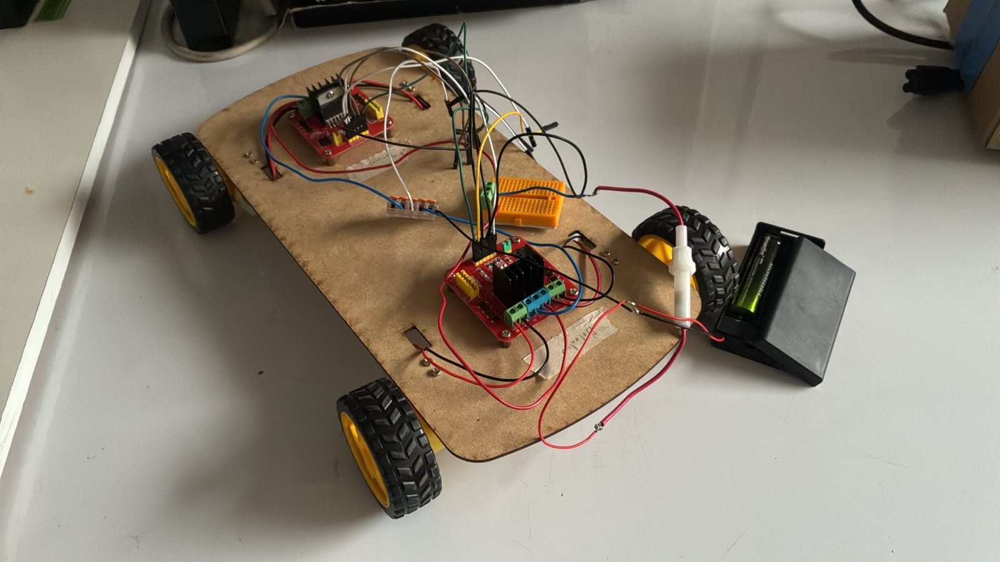
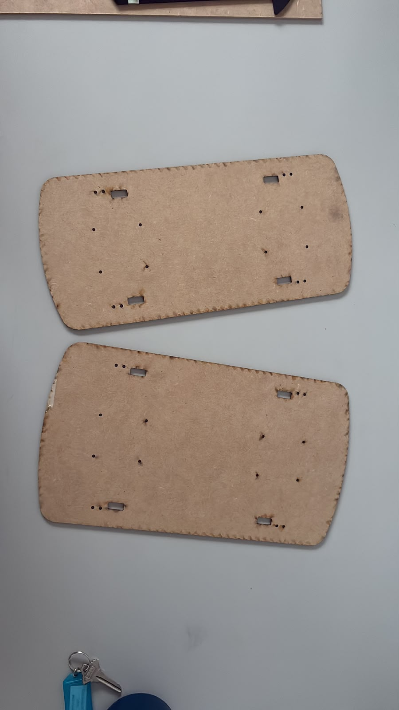
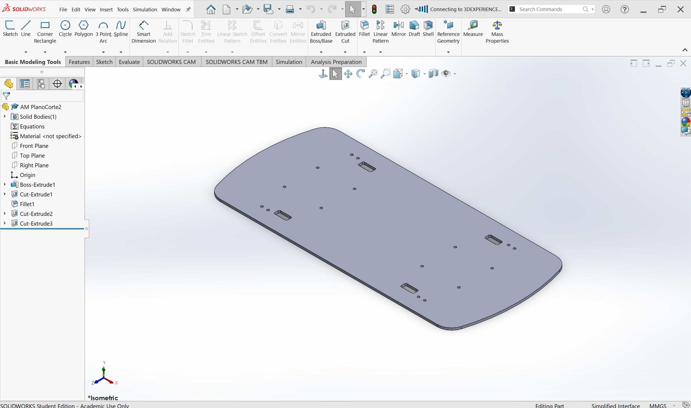

# Prototipo de chasis — AutoModelCar (TMR)

| Campo | Dato |
|---|---|
| Actividad | Investigación de materiales y prototipado de chasis para la categoría AutoModelCar del Torneo Mexicano de Robótica |
| Periodo | Otoño 2026 |
| Equipo y mi rol | Robótica — Área de Mecánica: investigación de materiales y diseño del prototipo de chasis |
| Herramientas | SolidWorks, corte láser en MDF |

**Objetivo:** Definir los materiales y diseñar un chasis para un vehículo autónomo a escala 1:10.

**Resultado:** Prototipo de chasis diseñado y fabricado en MDF.

## Evidencia
- Fotos: 

