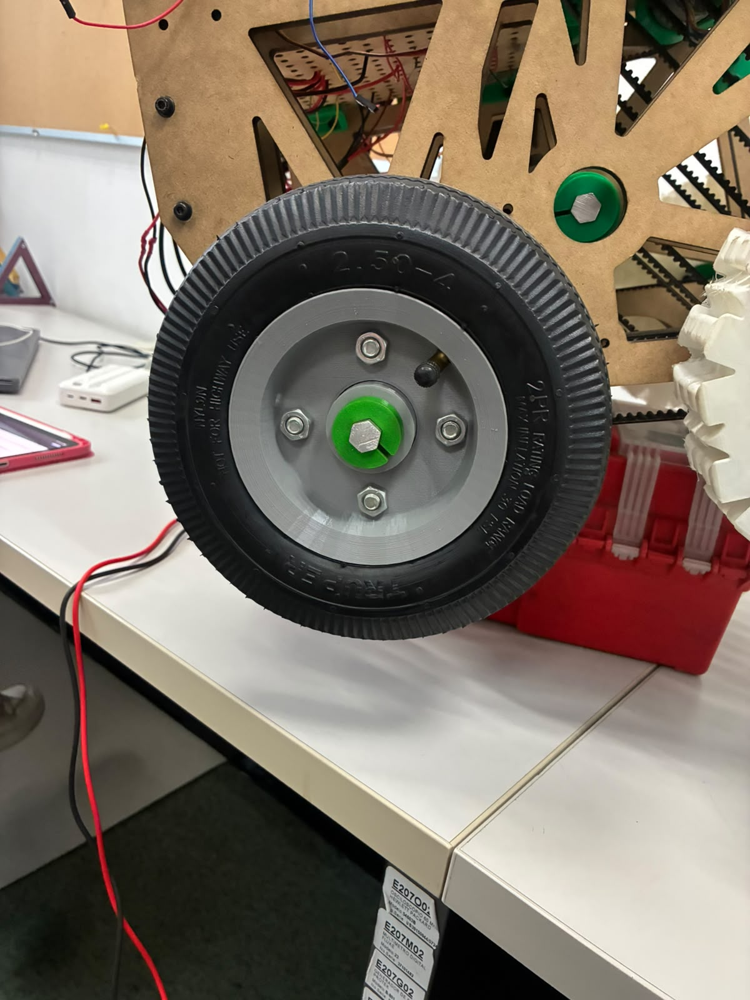

# Refacciones de Katarina

| Campo | Dato |
|---|---|
| Actividad | Medición, modelado e impresión 3D de refacciones para Katarina, robot autónomo de limpieza de playas (TMR) |
| Periodo | Otoño 2026 |
| Equipo y mi rol | Robótica — Área de Mecánica: medición de piezas existentes y modelado para su reproducción |
| Herramientas | SolidWorks, impresión 3D, PLA |

**Objetivo:** Reponer piezas que ya existían en el robot, midiéndolas para reproducirlas por impresión 3D.

**Resultado:** Engranes y rines de prototipo para llantas, modelados en SolidWorks e impresos en PLA.

## Evidencia
- Fotos:

