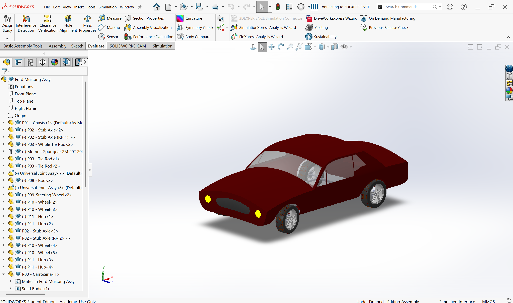
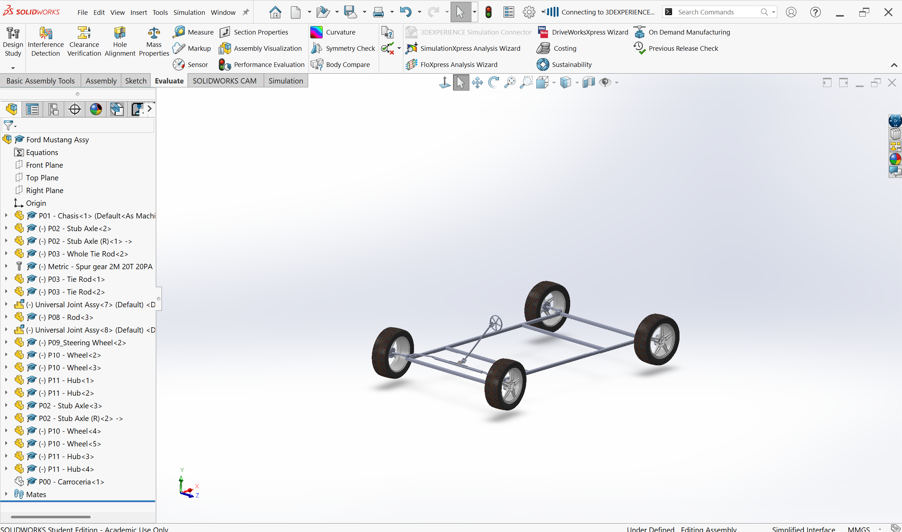

# Chasis Ford Mustang '65 para detección autónoma de baches (ROS2)

| Campo | Dato |
|---|---|
| Actividad | Modelado de un chasis Ford Mustang para un sistema de detección de baches autónomo en ROS2 |
| Periodo | Verano 2026 |
| Equipo y mi rol |Diseño del chasis y del sistema de dirección (proyecto individual) |
| Herramientas | SolidWorks, ROS2 |

**Objetivo:** Contar con un modelo de vehículo con geometría y dirección realistas para el programa de simulación de detección de baches en ROS2.

**Resultado:** Chasis diseñado en SolidWorks con dirección Ackermann de cremallera y piñón: mangueta, cremallera, bieletas, piñón y ruedas.

## Evidencia
- Fotos: 

