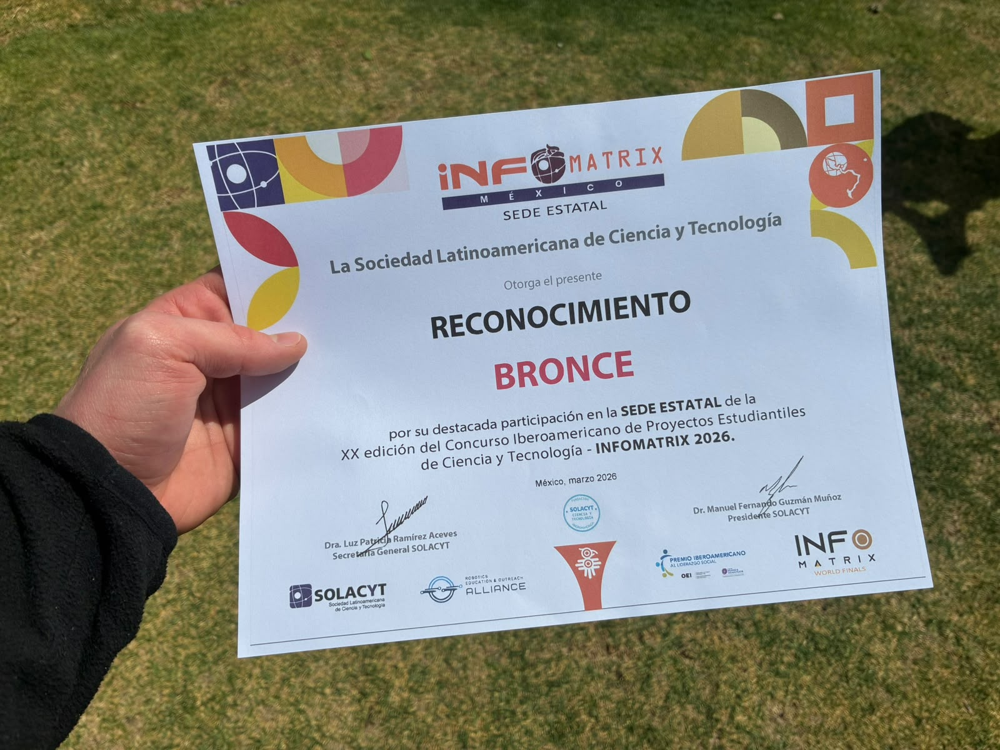
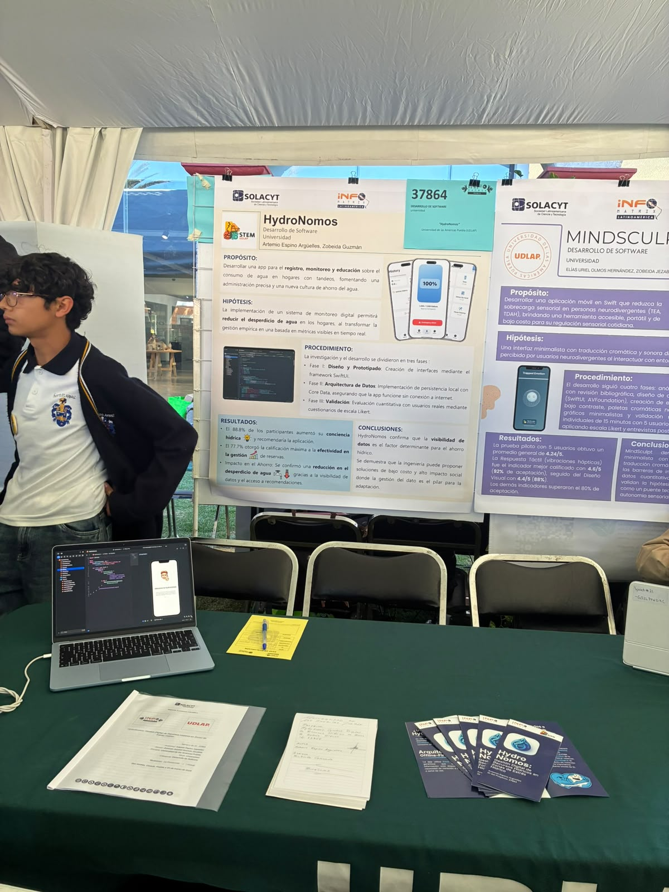
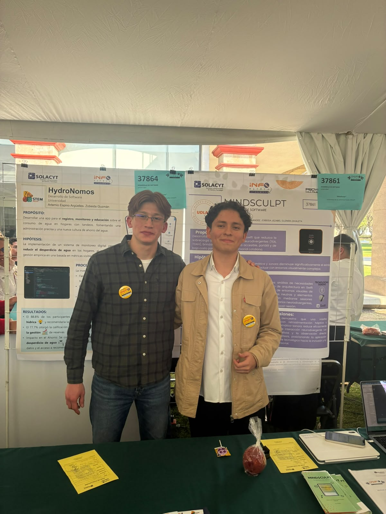

# HydroNomos

| Campo | Dato |
|---|---|
| Competencias | Swift Student Challenge 2026 · Infomatrix Puebla 2026 |
| Fecha y sede | Swift Student Challenge: remoto, 6 al 28 de febrero de 2026 · Infomatrix Puebla: 20 de marzo de 2026, Puebla |
| Equipo y mi rol | Desarrollo y diseño (proyecto individual) |
| Reconocimiento | 🥉 Medalla de Bronce (Infomatrix Puebla 2026) · Participación (Swift Student Challenge 2026) |
| Stack | Swift, SwiftUI, Core Data (offline-first) |

**Problema:** La escasez de agua exige gestionar mejor el recurso disponible.

**Solución:** App de gestión hídrica para momentos de escasez, que funciona sin conexión.

## Evidencia
- Repositorio: https://github.com/artemio-esp/HydroNomos
- Fotos: 

