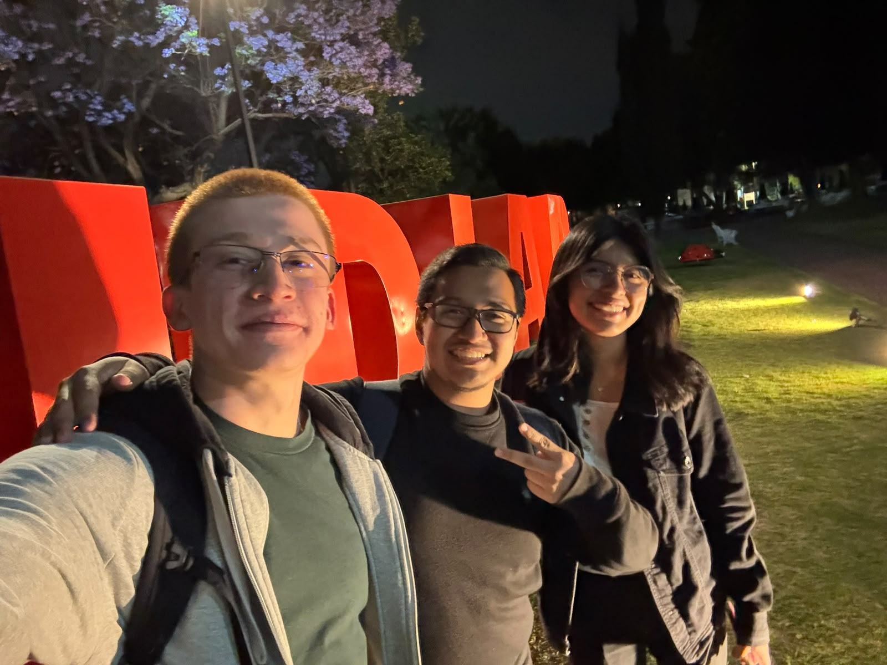
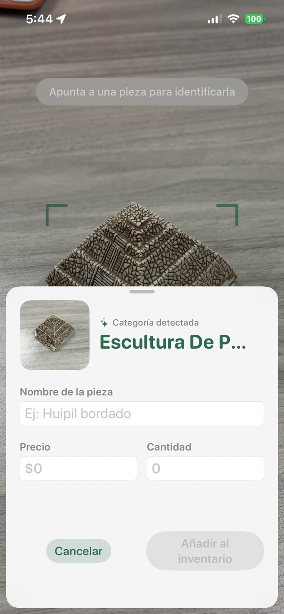
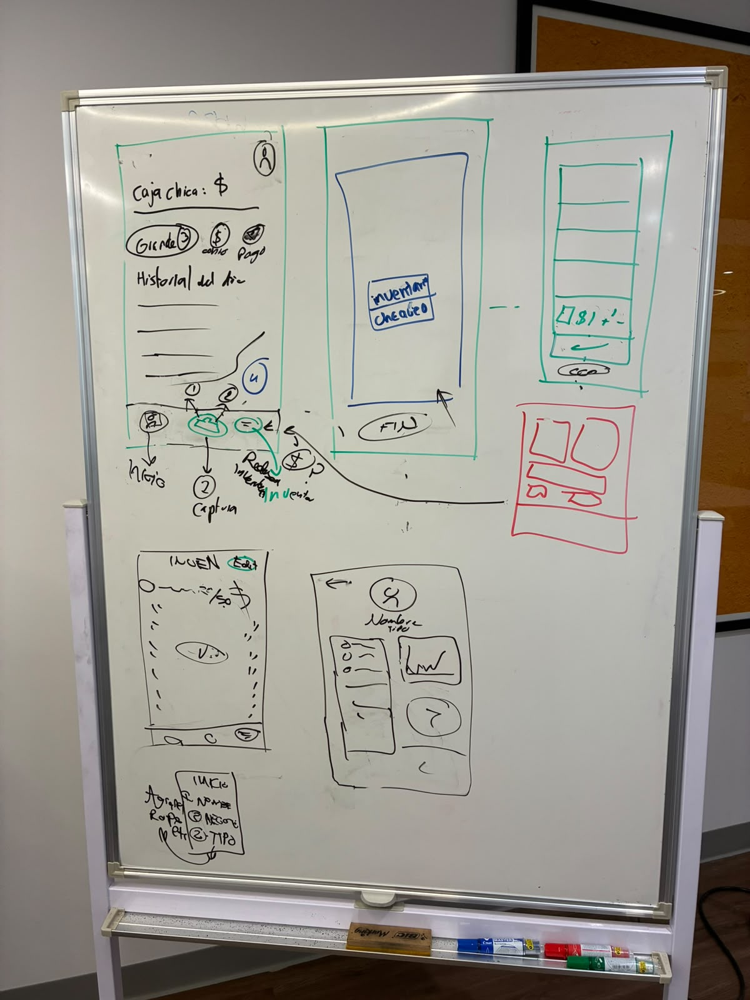

# Tlane

# Tlane

| Campo | Dato |
|---|---|
| Competencia | Hackathon Local iOS UDLAP 2026 |
| Fecha y sede | 18 al 20 de abril 2026, UDLAP |
| Equipo y mi rol | Con @Jesus17632 — mi rol: entrenador de modelos |
| Reconocimiento | 🏆 Ganador |
| Stack | Swift, SwiftUI, SwiftData, CoreML |

**Problema:** Los vendedores artesanos llevan su inventario a mano o de memoria, lo que dificulta saber qué tienen, qué se vendió y qué reponer.

**Solución:** App de inventario para vendedores artesanos con reconocimiento de productos por CoreML.

**Extra:** usado como caso real en un taller de 25 min de CoreML/SwiftUI.

## Evidencia
- Repositorio: https://github.com/artemio-esp/Tlane
- Fotos: 

